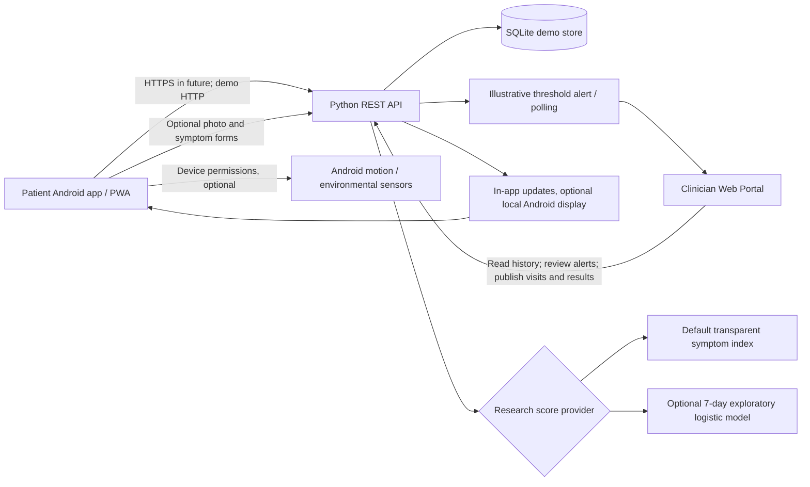

# HIDVIA system architecture (research demo)

## Data flow

1. Patient enters pain, itching, swelling, fatigue, stress, sleep, drainage, site and free-text early signs. Image choice is optional. User may explicitly opt to attach a current available sensor snapshot.
2. The offline patient app calculates an **illustrative** symptom signal using its bundled JavaScript logic, stores fictional entries in local WebView storage and is useful without server, sensor permission or calibration. This is not a medical prediction and does not upload offline entries automatically.
3. The online patient app authenticates to the REST server with demo bearer tokens and posts check-in fields. The server recomputes (never trusts client-side) the score and creates a clinician alert on elevated/high **demo** levels.
4. The clinician app authenticates separately. Clinicians can browse fictional patient records including notes, review alerts, mark them reviewed, enter appointments, test-result updates and visit notes.
5. Patient polls new entries while foregrounded. If Android notifications were allowed, the native wrapper requests display of a local notification. There is no robust background push, escalation or guaranteed delivery. Direct Fitbit/Garmin use is not implemented.

## Android sensor permission boundaries

Sensor manager can read (if present) accelerometer, gyroscope, ambient light, barometric pressure and proximity. The step counter requires `ACTIVITY_RECOGNITION` permission on supported Android versions; device heart-rate readings require `BODY_SENSORS`, and most phones lack heart-rate sensors. **Step-counter values are cumulative since device boot, not daily activity totals.** Explicit sensor reading is available from Settings, and attaching a snapshot to an online check-in is opt-in. No microphone or GPS collection is implemented. No biometric or medical inference is based on these sensor values by default.

## Proposed medically useful features beyond the demo

Consider longitudinal pain and lesion reports, flare-onset clinician adjudication, photo time series with controlled lighting and image calibration standards, treatment changes, medication adherence, menstrual/hormonal context with explicit consent, sleep/step/heart-rate trends via **Health Connect**, and external environment context only when clinically justified. Evaluate the value of each modality and missingness before adding it to a model.

Fitbit Charge 6 integration requires approved provider APIs or supported Health Connect transfer, account authorization and appropriate scope/consent. Garmin data integration depends on Garmin Connect developer access or Garmin Health SDK approval. *Phone app notification mirroring* is a wearable companion setting, not a general provider push API.

## Production target (not implemented)

Mobile -> HTTPS API gateway -> OIDC/SSO/2FA -> RBAC patient/clinical assignment -> encrypted relational DB + encrypted object storage -> audit/event bus -> clinical prediction service with validated model registry -> alerts with escalation/acknowledgment SLAs -> FCM/APNs or device-specific push -> optional HL7 FHIR hospital interoperability -> appointment/result EHR synchronization.

### Prototype trust boundaries and known limitations

- Debug-only simple bearer auth with in-memory sessions; no token expiry or account recovery.
- Local demo server defaults to 127.0.0.1. LAN host mode uses HTTP without TLS; forbidden for real health data.
- SQLite is not encrypted; no retention and deletion policies.
- No clinician-to-patient scoping across multiple clinic tenants; current demo has one seeded patient.
- WebView JavaScript bridge and remotely hosted pages require stringent trusted-domain restrictions and hardening before production.
- Photo upload checks content type/signature and file size only; it does not remove EXIF/geolocation metadata or sanitize every image format. Camera output through Android MediaStore may leave a demo picture in device media storage.
- Browser/Android offline local storage is not encrypted.
- Demo alert thresholds have no established sensitivity, precision or clinical utility.
- Permission requests, media selection and UI insets are only source-implemented, not tested on physical devices.
